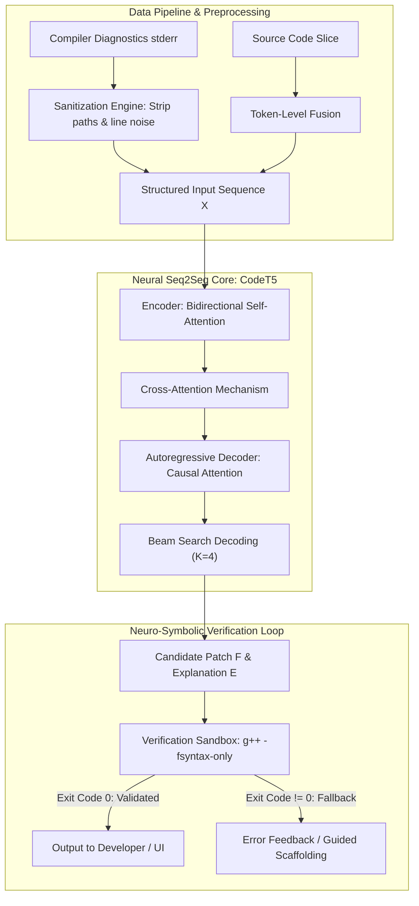

# C++ AI Tutor: System Architecture & Technical Specifications

An in-depth technical resource detailing the machine learning theory, architectural decisions, mathematical foundations, evaluation benchmarks, and design trade-offs for the **C++ AI Tutor (TOACD)** system.

---

## 1. System Overview & Formal ML Formulation

The **C++ AI Tutor** formulates compiler diagnostic remediation as a **conditional sequence-to-sequence (Seq2Seq)** translation problem augmented with **neuro-symbolic compiler feedback**.

### Mathematical Problem Definition
Given:
* An ill-formed C++ program $P \in \mathcal{L}_{\text{C++}}$
* A deterministic compiler diagnostic sequence $D = \{d_1, d_2, \dots, d_m\} = \text{stderr}(\mathcal{C}(P))$
* A localized program slice $S_P \subset P$ centered on the error locus $(line, col)$

The system models the conditional posterior probability:
$$P_\theta(Y \mid X) = \prod_{t=1}^{T} P_\theta(y_t \mid y_{<t}, X)$$
Where:
* Input representation: $X = \text{Concat}(\text{Prefix}, D, \langle\text{sep}\rangle, S_P)$
* Target sequence: $Y = \{y_1, \dots, y_T\}$ encoding both the **Pedagogical Explanation ($E$)** and the **Executable Patch ($\Delta P$)**.
* Parameters $\theta$ are optimized by minimizing standard Cross-Entropy under teacher forcing:
$$\mathcal{L}_{\text{CE}}(\theta) = - \sum_{t=1}^{T} \log P_\theta(y_t^* \mid y_{<t}^*, X)$$

---

## 2. Core Architectural Decisions: The "Why" Matrix

The following matrix details the engineering and mathematical trade-offs for each architectural component:

| Architectural Component | Decision Made | Alternative Considered | Mathematical / Systems Justification |
| :--- | :--- | :--- | :--- |
| **Model Family** | **Encoder-Decoder** (*CodeT5-base*, 220M) | **Decoder-Only** (e.g. LLaMA, Mistral, GPT-2) | Encoder-decoders utilize **bidirectional self-attention** across the entire compiler trace before generation begins. Decoder-only models use causal masking, preventing token $x_1$ from attending to $x_m$ without autoregressive overhead. |
| **Model Choice** | **CodeT5** | **BERT** / **RoBERTa** | BERT is encoder-only; it can classify error types or tag error tokens via token classification, but fundamentally cannot generate variable-length explanations or multi-line code patches. |
| **Domain Adaptation** | **Code-Aware Pre-training** | **Standard T5 / BART** | Standard NLP tokenizers shatter code primitives (`std::vector<int>`, `->`, `cout`) into multiple meaningless subword fragments. CodeT5 uses a specialized code-aware BPE vocabulary and identifier-aware pre-training objectives (Masked Identifier Prediction). |
| **Decoding Strategy** | **Beam Search ($K=4$)** | **Top-$p$ (Nucleus) / Temperature Sampling** | Stochastic sampling is suited for creative storytelling. Compiler diagnostics require **factual determinism** and high-probability syntactic paths: $\arg\max_Y \sum \log P(y_t \mid y_{<t}, X)$. Beam search prevents premature low-probability syntax hallucinations. |
| **Inference Footprint** | **Local / Edge SLM** (220M) | **Cloud API LLMs** (GPT-4 / Claude) | A CLI compiler replacement cannot incur a 1,200ms cloud round-trip, network dependency, or API cost per build. A 220M parameter model runs in **<90ms locally** with private, offline execution. |

---

## 3. Quantitative Evaluation Benchmark (Beyond Loss)

Standard NLP metrics like BLEU or ROUGE are fundamentally inadequate for code and compiler diagnostics:
* **The Negation Blindness of BLEU**: *"Add `#include <iostream>`"* vs *"Do not add `#include <iostream>`"* shares an 80% BLEU score despite opposite semantics.
* **The Perplexity Disconnect**: A model can achieve low cross-entropy validation loss while generating code that fails compilation due to a single misplaced closing brace `}`.

### The 4-Tier Evaluation Protocol (Implemented in `evaluate.py`)

1. **Pass@1 (Functional Execution Check)**:
   Measures whether the generated code patch compiles cleanly:
   $$\text{Pass@1} = \frac{1}{N} \sum_{i=1}^{N} \mathbb{I}\left(\text{exit\_code}\left(\texttt{g++ -fsyntax-only } \mathcal{P}(C_i, F_i)\right) == 0\right)$$
2. **Root-Cause Accuracy (RCA)**:
   Categorical match measuring if the explanation correctly identifies the true compiler failure stage (Syntax Delimiter, Undeclared Identifier, Type Coercion, Linker Symbol, Missing Header).
3. **Token-Level F1 / CodeBLEU**:
   Balances token precision and recall against ground-truth expert explanations, with CodeBLEU incorporating AST subtree matching and dataflow edge matches.
4. **Error Cascade Reduction Rate ($\Delta_{\text{err}}$)**:
   Measures the reduction in downstream compiler diagnostic lines on multi-error source files.

---

## 4. Advanced Additions & Future Architecture Upgrades

The following extensions outline production-scale architectural enhancements:

### A. Parameter-Efficient Fine-Tuning (PEFT / LoRA)
* **Mechanism**: Instead of full parameter updates on all 220M weights, freeze $W_0$ and inject trainable low-rank decomposition matrices $A$ and $B$:
  $$W = W_0 + \Delta W = W_0 + \frac{\alpha}{r} B \cdot A, \quad B \in \mathbb{R}^{d \times r}, A \in \mathbb{R}^{r \times k}, \; r \ll d$$
* **Impact**:
  * Reduces trainable parameters by **>98%** (from 220M to ~1.8M).
  * Eliminates **catastrophic forgetting** of general C++ syntax learned during pre-training.
  * Allows hot-swapping compiler adapters (e.g., `gcc_adapter.bin` vs `clang_adapter.bin` vs `msvc_adapter.bin`) on a single base model.

### B. Multi-Task Learning Objective (Joint Diagnostic Head)
* **Formulation**: Rather than relying purely on text generation, attach a secondary classification head to the encoder's pooled representation:
  $$\mathcal{L}_{\text{total}} = \mathcal{L}_{\text{seq2seq}} + \lambda_1 \mathcal{L}_{\text{classification}}(\hat{y}_{\text{stage}}, y_{\text{stage}}) + \lambda_2 \mathcal{L}_{\text{localization}}(\hat{y}_{\text{line}}, y_{\text{line}})$$
* **Impact**: Forcing the encoder to explicitly classify the compiler stage (e.g. Type Checking vs Syntax Parsing) regularizes the latent space and prevents the decoder from hallucinating generic explanations.

### C. Direct Preference Optimization (DPO) for Pedagogical Scaffolding
* **Problem**: Supervised fine-tuning (SFT) can teach the model to give the correct answer, but it may deliver cryptic explanations or spoon-feed answers without teaching.
* **DPO Formulation**: Train on preference pairs $(y_w \succ y_l)$, where $y_w$ is a structured 3-part pedagogical explanation (*What, Why, How*) and $y_l$ is a raw, jargon-heavy snippet:
  $$\mathcal{L}_{\text{DPO}}(\theta; \pi_{\text{ref}}) = -\mathbb{E}_{(x, y_w, y_l)} \left[ \log \sigma \left( \beta \log \frac{\pi_\theta(y_w \mid x)}{\pi_{\text{ref}}(y_w \mid x)} - \beta \log \frac{\pi_\theta(y_l \mid x)}{\pi_{\text{ref}}(y_l \mid x)} \right) \right]$$

### D. RAG-Augmented cppreference Retrieval for Template Errors
* **Problem**: C++ Template Metaprogramming errors (e.g., SFINAE, `std::enable_if`, concept mismatches) generate 4,000+ characters of compiler traces that exceed small model context windows.
* **Solution**: Index the ISO C++ standard library documentation (`cppreference`) in a vector store (e.g., FAISS). When an unrecognized template signature is identified, retrieve the exact class prototype and inject it into the prompt.

---

## 5. Frequently Asked Architectural Questions & Technical Explanations

### Q1: Why fine-tune a 220M CodeT5 model instead of using the OpenAI GPT-4o API?
> **Answer**: Three core engineering reasons:
> 1. **Latency & Throughput**: This tool acts as an active compiler wrapper (`tutor.py`). Developers compile dozens of times an hour. Cloud API calls introduce 800–1500ms latency, whereas an on-device 220M model running with ONNX or FP16 achieves sub-90ms response times.
> 2. **Offline Privacy**: Production enterprise code and proprietary C++ cannot be shipped over third-party APIs.
> 3. **Deterministic Specialization**: A fine-tuned domain-specific model consistently adheres to our strict output schema without prompt drift or unnecessary verbosity.

### Q2: How did you handle the exposure bias inherent in teacher forcing?
> **Answer**: During training, the decoder always conditions on the ground-truth prefix $y_{<t}^*$, but during autoregressive inference it conditions on its own generated tokens $\hat{y}_{<t}$. This can cause compounding error drift. We mitigate this by:
> 1. Using **Beam Search ($K=4$)** with length penalties to prune degenerative paths.
> 2. Applying **Label Smoothing ($\epsilon=0.1$)** over the vocabulary distribution to prevent overconfident single-token predictions.
> 3. Future iterations can incorporate **Scheduled Sampling** or **DPO** to align training and inference token distributions.

### Q3: Why did you pick CodeT5 over BERT or GPT-2?
> **Answer**: 
> * **BERT is encoder-only**: It lacks an autoregressive generation head, making it incapable of producing multi-line code remediation or natural language explanations.
> * **GPT-2 is decoder-only**: While capable of text generation, causal attention prevents input tokens from attending bidirectionally to downstream compiler diagnostics.
> * **CodeT5 is an encoder-decoder**: It allows full bidirectional cross-attention over the entire compiler error trace and code context before autoregressively generating the repair. Furthermore, CodeT5's BPE tokenizer was explicitly trained on programming languages, preserving identifier structure.

### Q4: How do you prevent hallucinations in generated C++ fixes?
> **Answer**: We employ a **Neuro-Symbolic Verification Loop**:
> The model's proposed code modification is not blindly returned to the developer. Instead, the runtime environment applies the patch to a sandboxed temporary file and invokes `g++ -fsyntax-only`. If the exit code is non-zero (i.e. the fix fails syntax checks), the system flags the uncertainty and provides a fallback guided hint rather than bad code.

### Q5: How do you address class imbalance in compiler errors?
> **Answer**: In real-world codebases, syntax errors (missing semicolons, unmatched braces) appear with orders of magnitude higher frequency than complex template instantiation failures. If trained naively, the model collapses into predicting trivial syntax errors. We address this by:
> 1. Stratified sampling during dataset aggregation.
> 2. Applying **Focal Loss** or class-weighted cross-entropy to up-weight rare semantic and linker errors.
> 3. Synthetic mutation injection in `generate_dataset.py` targeting specific under-represented AST node errors.

### Q6: Why did you choose Beam Search over Nucleus (Top-p) Sampling?
> **Answer**: Nucleus sampling introduces stochastic variance, which is valuable in creative dialogue but detrimental in programming language diagnostics. In C++, precision is paramount: generating `std::cout` vs `std::cin` is a binary difference between correct and broken code. Beam search ($K=4$) searches the most probable joint probability trajectories, yielding deterministic, syntactically coherent explanations.

### Q7: Why are BLEU and ROUGE misleading metrics for this task?
> **Answer**: BLEU and ROUGE evaluate surface n-gram overlap. In software engineering:
> 1. Changing variable names (e.g. `int counter` to `int idx`) destroys BLEU score while preserving 100% semantic correctness.
> 2. BLEU suffers from negation insensitivity (*"include `<vector>`"* vs *"do not include `<vector>`"*).
> Therefore, we prioritize **Pass@1** (compilation success), **CodeBLEU** (which factors in AST structure and data flow), and **Root-Cause Accuracy (RCA)**.

### Q8: What happens when the compiler error trace exceeds the maximum token length (512 tokens)?
> **Answer**: C++ template errors often exceed 2,000 tokens. Truncating from the end loses critical compiler notes. We employ a **Hierarchical Sanitization and Pruning Pipeline**:
> 1. Regex stripping of system directory paths (`/usr/include/...`).
> 2. Retention of the primary `error:` line and the immediate `note:` lines, discarding intermediate macro expansion stacks.
> 3. Extraction of the caret line and error locus column.

### Q9: How would you scale training if the dataset grew to 1,000,000 error pairs?
> **Answer**:
> 1. Migrate from standard single-GPU training to **Distributed Data Parallel (DDP)** across multiple nodes.
> 2. Transition from full fine-tuning to **LoRA / QLoRA (4-bit base weights)** to reduce memory bandwidth bottlenecks.
> 3. Implement **FlashAttention-2** to accelerate encoder cross-attention computations.
> 4. Use dynamic batching and sequence packing to minimize padding token waste.

### Q10: How would you deploy this model to production in an IDE?
> **Answer**:
> 1. Export the fine-tuned PyTorch checkpoint to **ONNX Runtime** or **TensorRT-LLM**.
> 2. Apply **INT8 Post-Training Quantization (PTQ)**, shrinking model size from ~890MB to ~225MB with <0.5% degradation in Pass@1.
> 3. Package the inference runtime inside a lightweight background daemon communicating via the **Language Server Protocol (LSP)** to VS Code or CLion.
